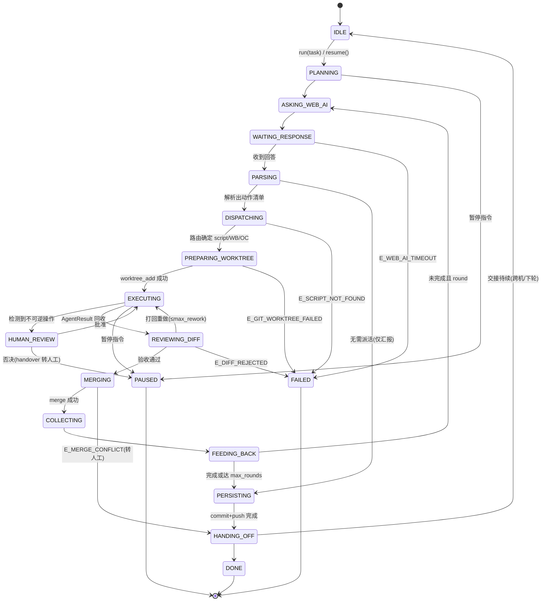
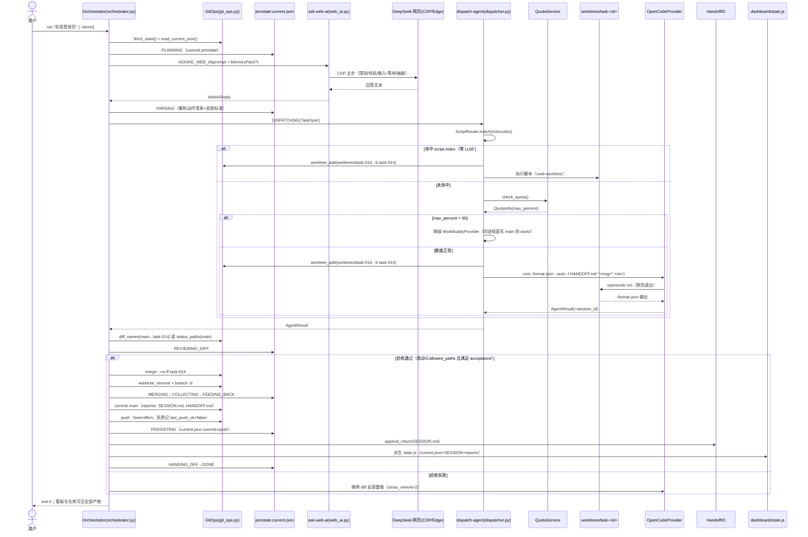
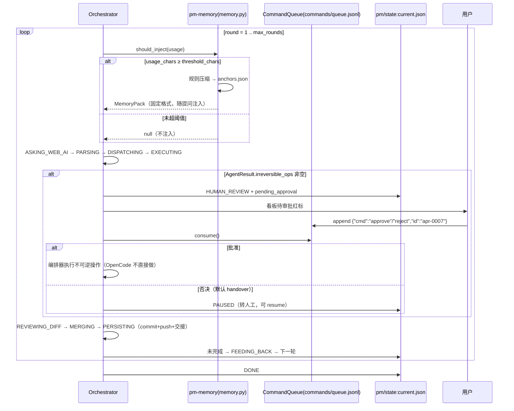
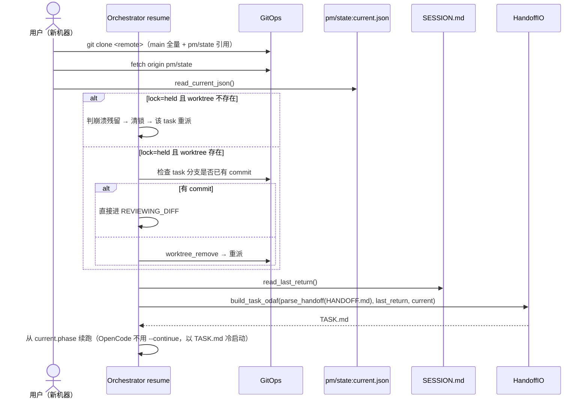
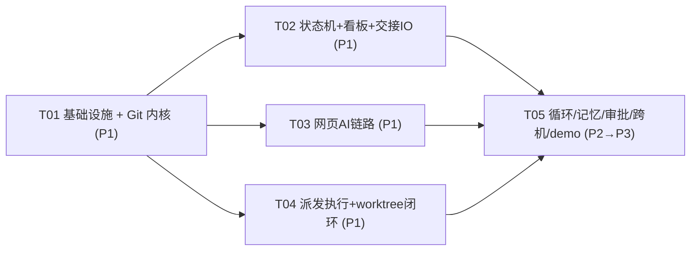

# ARCHITECTURE v2 — Windows 本地「项目经理」编排器（Git 交接模型）

> 版本：v2.0 · 作者：高见远（架构师） · 日期：2026-10-20
> 输入：PRD.md（许清楚）＋ ARCHITECTURE.md v1.0（本文档的增量修订基线）＋ 用户确认的 Git 交接模型设计方向
> 读者：工程师（照第 7 章任务清单执行）、团队负责人
> 修订性质：**增量修订**。v1 的 13 态状态机、lib 划分、错误码、看板双文件方案多数保留；本次把「进程级并发 + 单机 state.json 真源」改为「串行交接 + Git 单一事实源」。

---

## 1. 修订说明（相对 v1 改了什么、为什么）

| # | v1 设计 | v2 设计 | 原因 |
|---|---------|---------|------|
| R1 | `state.json` 放 main 根目录，是**唯一状态真源**，编排器独占写 | 状态拆两层：`main` 只承载**产出与交接文件**；`pm/state` 孤儿分支只放 `state/current.json` 最小指针（phase/round/active_agent/task_id/lock/pending_approval/iteration/last_commit/last_push_ok/updated_at） | Git 是单一事实源；已完成子任务/代码/报告由 commit 历史与 `reports/` 表达（**derive don't mirror**），不写大而全 state.json 到 main |
| R2 | `locks/agent.lock` 进程级互斥锁（PID 探活 + TTL） | **删除进程锁类**；`current.json.lock` 仅作跨机「上次是否中断」恢复判定：`lock=held` 但 worktree 不存在 → 崩溃残留 → 清锁重派；worktree 存在且 task 分支有 commit → 直接进 `REVIEWING_DIFF` | 使用模式是串行交接、非并发；锁的唯一残余价值是崩溃恢复 |
| R3 | OpenCode CLI 直接在仓库根跑（cwd=root） | OpenCode **永远在 git worktree 工作**：派活前 `git worktree add worktrees/task-<id> -b task-<id> main`，worktree 路径作 `opencode run` 的 `<directory>`；完成后编排器查 diff、对照验收，通过才 `merge --no-ff` 回 main；主工作区**永不切分支** | 隔离代理改动、保护 main、支持中断后续派；merge 前人工/规则验收 |
| R4 | 无交接协议；循环靠多次调用同一台机器 | **三文件交接协议**（都在 main，随 commit 更新）：`HANDOFF.md`（中断方摘要，五块结构）/ `SESSION.md`（append-only 执行日志，接手方追加 `## ↪ Return` 块，只追加不修改→无合并冲突）/`TASK.md`（编排器据 HANDOFF + SESSION 最后 ↪ Return 生成的 ODAF 任务书） | 支持跨机器/跨软件接续；OpenCode `--continue` 仅本机有效，跨机以文件冷启动 |
| R5 | 落盘即终点，无版本历史 | 每轮关键状态转换后 **commit + push**（best-effort，失败不阻塞、下轮 PERSISTING 重试）；push 目标含 main 与 `pm/state` | 崩溃/换机最多丢失一个未完成转换；GitHub private 仓库即备份与接续载体 |
| R6 | skills 放 `skills/`，假设 WB 自动发现 | skills 放仓库 `.workbuddy/skills/`；`pm-orchestrator/SKILL.md` 开头写**环境自检**：若当前 WB 会话未加载这些 skill，提示复制目录到 `~/.workbuddy/skills/`（解法 A，不引 TeamAI） | 仓库随 clone 走，新机器开箱即用；同步非自动，避免静默失效 |
| R7 | 看板数据源 = `state.json` 同步生成 `dashboard/state.js`（入库） | `dashboard/index.html` 单文件只读不变；`dashboard/state.js` 改为**派生缓存**：每次 commit 时从 `current.json` + `SESSION.md` 摘要 + `reports/` + `git log` 派生生成，**gitignore 掉**；index.html 对缺失 state.js 优雅降级（显示「等待编排器首次运行」） | 符合 derive 原则；派生物不入库避免双写漂移 |
| R8 | `commands/queue.jsonl` 模式 B 预留 | 保留为**审批/指令通道**（approve/reject/pause/resume），append-only NDJSON，入库留痕；`current.json.pending_approval` 只放当前待决指针 | 串行模型下审批仍需异步回写入口；决策历史进 Git |
| R9 | 额度源 = HTTP usage API 单一来源 | **双源优先级**：`opencode stats --json --days N --project . --cost`（本地 CLI，无网络依赖）优先 → HTTP `GET https://opencode.ai/zen/go/v1/usage` 兜底；都查不到 `stale=true` **不拦截** | 本地统计零网络依赖更稳；percent 口径见 §11 待明确 Q2 |
| R10 | WorkBuddyProvider 语义模糊 | 明确为**同进程执行器**：WB 即编排器宿主本身，`run()` 后由当前会话把改动直接写在 main 的 `work/` 下，`REVIEWING_DIFF` 走 `git status` 未提交改动审查 → 提交。OpenCode 走 worktree 路径 | WB 5.8.3 同进程零内存，天然执行器；两条执行路径统一收口到 diff 审查 |
| R11 | 无离线验证设计 | 全链路 `--demo`/mock：假 DeepSeek 回复 + 假 OpenCode 结果，但 **Git 操作全真**（含本地 bare remote 练 push）；QA 无网页 AI、无真实 OpenCode 配额也能验证 Git 落盘/worktree 隔离/交接文件/路由/记忆/看板派生 | 内存铁约束 + 外部依赖不可控；离线可验证是验收前提 |

**保留不动的部分**：4 个项目级 skill 划分、脚本优先路由（script-index 10 条）、记忆规则压缩（字符阈值、固定注入格式）、看板五区单文件 HTML、错误码主体、能力缺口不阻塞、P3 扩展项（WebAIAdapter/ChatGPT 占位/SQLite）。

---

## 2. 实现方案与框架选型（增量）

### 2.1 新增技术难点与对策

| # | 难点 | 设计对策 |
|---|------|----------|
| D8 | 零常驻 + 跨机器接续：进程退出后状态不能丢，换机后要能续跑 | **Git 即状态机外存**：`pm/state` 孤儿分支 `state/current.json` 记最小指针；`SESSION.md` append-only 记执行史；新机 `clone → fetch pm/state → 读指针 + 最后 ↪ Return → 生成 TASK.md` 续跑 |
| D9 | 代理（OpenCode）可能改坏主仓 | **worktree 隔离 + 合并前验收**：`git worktree add worktrees/task-<id> -b task-<id>`；`opencode run` 的 `<directory>` 指向 worktree；编排器 `git diff --name-only main...task-<id>` 审查，改动越界（不在允许路径）或验收不过 → 打回重做（≤`max_rework`）或放弃分支 |
| D10 | 孤儿分支写入不能切分支（主工作区要留在 main） | **git plumbing 写 pm/state**：`hash-object` → `GIT_INDEX_FILE` 临时索引 `read-tree/update-index/write-tree` → `commit-tree` → `update-ref`，全程不 checkout；读取用 `git show pm/state:state/current.json` |
| D11 | 合并冲突在串行小仓库下的处理 | `merge --no-ff` 冲突 → `merge --abort` → 记 `E_MERGE_CONFLICT` → 生成 HANDOFF（含冲突文件清单）转人工；不在编排器内自动解冲突 |
| D12 | 交接文件并发写冲突 | `SESSION.md` **只追加**（`## ↪ Return` 块），`HANDOFF.md`/`TASK.md` 由编排器单点重写；三者都由编排器在 PERSISTING 一并 commit，无合并窗口 |
| D13 | push 失败不能断闭环 | `push` best-effort：失败记 `current.json.last_push_ok=false`，下一轮 PERSISTING 重试；本地 commit 永不被 push 失败阻塞 |

### 2.2 选型（相对 v1 的变化）

| 决策 | v2 选择 | 理由 |
|------|---------|------|
| 状态真源 | **Git：main（产出）+ `pm/state`（指针）** | 单一事实源、零额外存储、天然跨机 |
| 分支工作方式 | **git worktree（2.55.0 已装）+ plumbing 写孤儿分支** | 主工作区永不切分支；worktree 是目录不是进程，零内存成本 |
| 远端 | GitHub private（地址待用户填，见 §11 Q1）；demo 用本地 bare 仓库 | 跨机器接续载体 |
| 执行器 | WorkBuddy 同进程（main 直写）+ OpenCode CLI（worktree 子进程，跑完退出） | 不变；执行路径统一收口到 diff 审查 |
| 依赖 | 仍为 **Python 全标准库**；git 用 `subprocess` 调 CLI，不引 GitPython/pygit2 | 内存铁约束；git CLI 已实测可用 |

**架构模式**：分层 + 状态机 + 适配器 + **Git 交接层（新增）`lib/git_ops.py` + `lib/handoff_io.py`**。
- 表现层：`dashboard/index.html`（只读，轮询派生的 `state.js`）
- 编排层：`pm-orchestrator`（可重入状态机，唯一写 `current.json` 与交接文件者）
- 服务层：`ask-web-ai` / `dispatch-agent` / `pm-memory` / **GitOps / HandoffIO**
- 数据层：`pm/state:state/current.json`（指针）/ main 上 `work/ reports/ memory/ HANDOFF.md SESSION.md TASK.md commands/`
- 跨层通信：只走文件系统 + git CLI，无 socket、无共享内存

---

## 3. 文件/目录树（根 = `pm-software/`）

```
pm-software/
├── ARCHITECTURE.md                  # v1（保留存档）
├── ARCHITECTURE-v2.md               # 本文档
├── PRD.md
├── pm.config.json                   # 全局配置（含 git/remote/opencode/quota/loop）
├── capabilities.json                # 代理探测结果（enabled:true|null，入库）
├── script-index.json                # 脚本优先路由索引（10 条 + exclude）
├── HANDOFF.md                       # 交接摘要（中断方/编排器生成，五块结构）
├── SESSION.md                       # append-only 执行日志（只追加 ↪ Return 块）
├── TASK.md                          # ODAF 任务书（接手方冷启动输入，编排器生成）
├── .gitignore                       # 见下方专述
├── .workbuddy/
│   └── skills/                      # 4 个项目级 skill（随仓库 clone 走）
│       ├── pm-orchestrator/
│       │   ├── SKILL.md             # 状态机 + 调用约定 + 环境自检段（skill 同步说明）
│       │   └── orchestrator.py      # 状态机驱动 + GitOps 编排 + state.js 派生
│       ├── ask-web-ai/
│       │   ├── SKILL.md             # 封装 browser-automation-cdp；写死禁加载 browser-agent/playwright
│       │   └── web_ai.py            # CDP 五步 + DeepSeek 选择器常量 + --demo mock
│       ├── dispatch-agent/
│       │   ├── SKILL.md             # 三段式路由 + worktree 生命周期说明
│       │   └── dispatcher.py        # ScriptRouter + Dispatcher（worktree 创建/回收/重做）
│       └── pm-memory/
│           ├── SKILL.md             # 阈值压缩 + 注入格式
│           └── memory.py            # MemoryService（规则压缩/anchors/记忆包渲染）
├── lib/                             # 共享 Python 模块（4 skill 复用）
│   ├── pm_common.py                 # 路径/原子写/NDJSON/错误码/ISO 时间/CLI 执行器
│   ├── git_ops.py                   # GitOps：init/commit/push/worktree/merge/state 读写
│   ├── handoff_io.py                # HandoffIO：HANDOFF/SESSION/TASK 渲染解析追加
│   ├── agent_provider.py            # AgentProvider ABC + WB/OC 实现 + demo mock
│   ├── webai_adapter.py             # WebAIAdapter ABC + DeepSeek + Mock（P3 ChatGPT 占位）
│   ├── quota.py                     # QuotaService：stats CLI 优先 + usage HTTP 兜底
│   ├── capability_probe.py          # DSH/OpenClaw/CodeBuddy 探测（不阻塞）
│   └── demo_fixtures.py             # demo 固定数据（假回复/假结果/假额度）
├── work/                            # 项目产出目录（代理改动只允许落这里；初始放 .gitkeep）
│   └── .gitkeep
├── worktrees/                       # git worktree 暂存区（gitignore；pm-state 持久 + task-* 临时）
├── reports/                         # 每轮 Markdown 报告 round-<n>-<ts>.md（入库）
├── memory/
│   ├── anchors.json                 # 固化锚点：决策/约束/偏好/进度（入库）
│   └── transcripts/                 # 每轮问答归档 round-<n>-<ts>.md（入库）
├── commands/
│   └── queue.jsonl                  # NDJSON 审批/指令通道（append-only，入库）
├── dashboard/
│   ├── index.html                   # 单文件看板（只读，五区，meta refresh 2s，入库）
│   └── state.js                     # 派生缓存（gitignore，不入库）
└── docs/                            # 图（mermaid 源文件）

# 孤儿分支 pm/state（orphan，唯一文件）：
pm/state
└── state/
    └── current.json                 # 最小状态指针，plumbing 写入，不 checkout
```

`.gitignore` 内容（T01 建）：
```
dashboard/state.js
worktrees/
*.tmp
__pycache__/
.demo-remote/
.DS_Store
```

**worktree 布局**：`worktrees/pm-state/` 不用——pm/state 走 plumbing 不占工作区；`worktrees/task-<id>/` 为每个派活任务的临时 linked worktree，merge 后 `worktree remove --force` + `git branch -d` 回收。

---

## 4. 核心数据结构与接口

### 4.1 状态机定义（v2：17 态，v1 13 态增量）



> 可重入约定：除 IDLE 外任一状态落盘（commit 到 pm/state）后进程退出均安全；下次调用从 `current.json` 恢复。**新增四个 Git 态**：`PREPARING_WORKTREE` / `REVIEWING_DIFF` / `MERGING` / `PERSISTING` / `HANDING_OFF`（实为 5 个，替换 v1 的 `DISPATCHING→EXECUTING` 直连）。

### 4.2 类图（v2：新增 GitOps / HandoffIO，删除 AgentLock）

```mermaid
classDiagram
    class LoopPhase {
        <<enumeration>>
        IDLE
        PLANNING
        ASKING_WEB_AI
        WAITING_RESPONSE
        PARSING
        DISPATCHING
        PREPARING_WORKTREE
        EXECUTING
        REVIEWING_DIFF
        MERGING
        HUMAN_REVIEW
        COLLECTING
        FEEDING_BACK
        PERSISTING
        HANDING_OFF
        DONE
        PAUSED
        FAILED
    }
    class AgentKind {
        <<enumeration>>
        script
        workbuddy
        opencode
        dsh
        openclaw
        codebuddy
    }
    class CurrentState {
        +str schema_version
        +str project
        +str status
        +str phase
        +int round
        +int iteration
        +str active_agent
        +str|None task_id
        +dict|None lock
        +dict|None pending_approval
        +str|None last_commit
        +bool last_push_ok
        +str updated_at
    }
    class PMStateView {
        +dict loop
        +dict quota
        +dict board
        +dict memory
        +list approvals
        +list capability_gaps
        +list history
        +derive_from(current, session_tail, reports, gitlog) PMStateView
    }
    class TaskSpec {
        +str id
        +str instruction
        +bool irreversible
        +str|None script_route
        +list acceptance
        +list allowed_paths
    }
    class AgentResult {
        +str status
        +str agent
        +str summary
        +list artifacts
        +list irreversible_ops
        +str|None error_code
        +str|None error_detail
        +str|None session_id
        +int duration_ms
    }
    class QuotaInfo {
        +str agent
        +float max_percent
        +dict windows
        +str source
        +str fetched_at
        +bool stale
    }
    class ContextUsage {
        +int chars_used
        +int chars_limit
    }
    class WebAIReply {
        +str text
        +ContextUsage context_usage
        +str|None raw_path
    }
    class MemoryPack {
        +str goal
        +list done
        +list blocked
        +str current_question
        +str updated_at
        +render() str
    }
    class Anchors {
        +list decisions
        +list constraints
        +list preferences
        +str progress
    }
    class ApprovalRequest {
        +str id
        +str op_type
        +str command
        +str requested_by
        +str status
        +str|None decision
        +str|None decided_at
    }
    class HandoffDoc {
        +str goal
        +list constraints
        +list key_files
        +list todos
        +list blockers
        +str generated_at
    }
    class ReturnBlock {
        +str ts
        +str agent
        +str did
        +list changed_files
        +str test_result
        +str report_path
        +str next_step
        +str note
    }
    class AgentProvider {
        <<abstract>>
        +run(task: TaskSpec, handoff_path: Path) AgentResult
        +check_quota() QuotaInfo
        +capabilities() dict
    }
    class WorkBuddyProvider
    class OpenCodeProvider
    class MockOpenCodeProvider
    class MockWorkBuddyProvider
    class WebAIAdapter {
        <<abstract>>
        +send_prompt(prompt: str, memory_pack: str|None) WebAIReply
        +get_context_usage() ContextUsage
    }
    class DeepSeekAdapter
    class MockWebAIAdapter
    class ChatGPTPlaceholderAdapter
    class GitOps {
        +is_repo() bool
        +init_repo(remote: str|None, demo: bool) void
        +ensure_state_branch() void
        +read_current_json() dict|None
        +write_current_json(state: dict, message: str) str
        +stage_and_commit(paths: list[str], message: str) str
        +push(branch: str, best_effort: bool) bool
        +push_state(best_effort: bool) bool
        +worktree_add(rel_path: str, branch: str, base: str) Path
        +worktree_remove(rel_path: str, force: bool) void
        +merge_task_branch(branch: str, message: str) dict
        +diff_names(base: str, branch: str) list[str]
        +status_paths(cwd_rel: str) list[str]
        +fetch(refspec: str) bool
        +head_sha(short: bool) str
    }
    class HandoffIO {
        +render_handoff(ctx: HandoffContext) str
        +write_handoff(content: str) void
        +parse_handoff(text: str) HandoffDoc
        +append_return(block: ReturnBlock) void
        +read_last_return() ReturnBlock|None
        +read_session_tail(n: int) list[ReturnBlock]
        +build_task_odaf(handoff: HandoffDoc, last_return: ReturnBlock|None, current: dict) str
        +write_task(content: str) void
    }
    class ScriptRouter {
        +match(instruction: str) Route|None
    }
    class Dispatcher {
        +dispatch(task: TaskSpec) AgentResult
    }
    class MemoryService {
        +compress(transcript: str) MemoryPack
        +should_inject(usage: ContextUsage) bool
        +update_anchors(pack: MemoryPack) void
        +render_pack(pack: MemoryPack) str
    }
    class CommandQueue {
        +append(cmd: dict) void
        +consume() list
    }
    class QuotaService {
        +fetch(force: bool) QuotaInfo
        -_from_stats_cli(project: str) QuotaInfo|None
        -_from_usage_http() QuotaInfo|None
    }
    class CapabilityProbe {
        +probe_all() dict
    }
    class Orchestrator {
        +run(task: str, max_rounds: int) int
        +resume() int
        -_transition(to: LoopPhase) void
        -_persist_git(message: str) void
        -_derive_state_js() void
        -_recover_lock() str
        -_review_diff(task: TaskSpec) bool
    }

    AgentProvider <|-- WorkBuddyProvider
    AgentProvider <|-- OpenCodeProvider
    OpenCodeProvider <|-- MockOpenCodeProvider
    WorkBuddyProvider <|-- MockWorkBuddyProvider
    WebAIAdapter <|-- DeepSeekAdapter
    WebAIAdapter <|-- MockWebAIAdapter
    WebAIAdapter <|-- ChatGPTPlaceholderAdapter
    Orchestrator --> GitOps : 读写分支/提交/推送
    Orchestrator --> HandoffIO : 生成交接三件套
    Orchestrator --> CurrentState : 唯一写者(经 GitOps)
    Orchestrator --> PMStateView : 派生看板
    Orchestrator --> MemoryService
    Orchestrator --> CommandQueue
    Orchestrator ..> WebAIAdapter : 经 ask-web-ai
    Orchestrator --> CapabilityProbe
    Dispatcher --> AgentProvider : 路由到
    Dispatcher --> ScriptRouter : 脚本优先
    Dispatcher --> QuotaService : 额度判定
    Dispatcher --> GitOps : worktree 生命周期
    MemoryService --> MemoryPack
    MemoryService --> Anchors
    Orchestrator --> ApprovalRequest : pending_approval
```



### 4.3 current.json schema（`pm/state` 孤儿分支唯一文件）

**铁律：只记无法从 Git 原生信息推导的内容。** 已完成子任务 → `git log`；报告位置 → `reports/`；执行史 → `SESSION.md`。一律不镜像进 current.json。

```json
{
  "schema_version": "2.0",
  "project": "pm-software",
  "status": "RUNNING",
  "phase": "EXECUTING",
  "round": 3,
  "iteration": 7,
  "active_agent": "opencode",
  "task_id": "task-014",
  "lock": {
    "state": "held",
    "holder": "task-014",
    "worktree": "worktrees/task-014",
    "branch": "task-014",
    "acquired_at": "2026-10-20T11:34:41Z"
  },
  "pending_approval": null,
  "last_commit": "a1b2c3d",
  "last_push_ok": true,
  "updated_at": "2026-10-20T11:34:41Z"
}
```

`pending_approval` 非空示例（待决指针，决策历史在 `commands/queue.jsonl`）：

```json
"pending_approval": {
  "id": "apr-0007",
  "op_type": "git_push",
  "command": "git push origin main",
  "requested_by": "opencode",
  "requested_at": "2026-10-20T11:35:02Z"
}
```

崩溃恢复判定（`Orchestrator._recover_lock()`）：

| current.json.lock | worktree 是否存在 | task 分支有无 commit | 恢复动作 |
|---|---|---|---|
| null | — | — | 正常进入 PLANNING |
| held | 否 | — | 崩溃残留：清 lock → 该 task 重派（PREPARING_WORKTREE） |
| held | 是 | 无 | 代理未落任何改动：`worktree_remove` → 重派 |
| held | 是 | 有 | 直接进 REVIEWING_DIFF（合并前验收） |

### 4.4 GitOps 接口（`lib/git_ops.py`，签名级）

```python
class GitOps:
    def __init__(self, root: Path, cfg: dict) -> None: ...
    def is_repo(self) -> bool: ...
    def init_repo(self, remote: str | None, demo: bool = False) -> None:
        """git init -b main；脚手架首 commit；add remote；ensure_state_branch()；
        demo=True 时额外在 .demo-remote/ 建 bare 仓库并设为 origin"""
    def ensure_state_branch(self) -> None:
        """pm/state 不存在则用 plumbing 建孤儿分支并写初始 current.json"""
    def read_current_json(self) -> dict | None:
        """git show pm/state:state/current.json；分支不存在返回 None"""
    def write_current_json(self, state: dict, message: str | None = None) -> str:
        """plumbing：hash-object -w → GIT_INDEX_FILE 临时索引 read-tree/update-index/write-tree
        → commit-tree（带 -p 旧commit）→ update-ref refs/heads/pm/state；返回新 commit sha。
        全程无 checkout，主工作区保持在 main"""
    def stage_and_commit(self, paths: list[str], message: str) -> str:
        """git add -- <paths>；git commit -m；返回 short sha。无变更返回空串"""
    def push(self, branch: str = "main", best_effort: bool = True) -> bool:
        """git push origin <branch>；best_effort=True 时失败仅返回 False 不 raise"""
    def push_state(self, best_effort: bool = True) -> bool: ...
    def worktree_add(self, rel_path: str, branch: str, base: str = "main") -> Path:
        """git worktree add <root>/<rel_path> -b <branch> <base>；返回绝对路径"""
    def worktree_remove(self, rel_path: str, force: bool = True) -> None:
        """git worktree remove --force；不存在则静默"""
    def merge_task_branch(self, branch: str, message: str) -> dict:
        """git merge --no-ff <branch> -m <message>（cwd=root，主工作区在 main）；
        返回 {"ok": bool, "sha": str, "conflicts": [paths]}；冲突先 merge --abort"""
    def diff_names(self, base: str, branch: str) -> list[str]:
        """git diff --name-only <base>...<branch>"""
    def status_paths(self, cwd_rel: str = ".") -> list[str]:
        """git status --porcelain（WB 同进程路径用：审查 main 未提交改动）"""
    def fetch(self, refspec: str = "pm/state") -> bool:
        """git fetch origin <refspec>"""
    def head_sha(self, short: bool = True) -> str: ...
```

**实现要点（工程师照做）**：
1. 所有 git 调用经 `pm_common.run_cli(argv, cwd, timeout_s)` 统一封装（capture stdout/stderr，超时 kill 进程树）。
2. `write_current_json` 的空树哈希用 git 内置常量 `4b825dc642cb6eb9a060e54bf8d69288fbee4904`（分支不存在时 `read-tree` 失败即用空树）。
3. `commit-tree` 需要 `-m` 消息与作者信息；作者取 `pm.config.json` 的 `git.author_name/author_email`。
4. Windows 下 `GIT_INDEX_FILE` 设为 `<root>/.git/pm-tmp-index`（用后删除）。

### 4.5 HandoffIO 接口（`lib/handoff_io.py`，签名级）

```python
@dataclass
class HandoffContext:   # render_handoff 的输入
    goal: str
    constraints: list[str]
    key_files: list[tuple[str, str]]     # (path, note)
    todos: list[str]
    blockers: list[str]
    generated_by: str
    hostname: str

@dataclass
class HandoffDoc:      # parse_handoff 的输出
    goal: str
    constraints: list[str]
    key_files: list[str]
    todos: list[str]
    blockers: list[str]
    generated_at: str

@dataclass
class ReturnBlock:     # SESSION.md 的一条 ↪ Return
    ts: str
    agent: str
    did: str
    changed_files: list[str]
    test_result: str
    report_path: str
    next_step: str
    note: str

class HandoffIO:
    def __init__(self, root: Path) -> None: ...
    def render_handoff(self, ctx: HandoffContext) -> str: ...     # 固定五块模板
    def write_handoff(self, content: str) -> None: ...            # 覆盖写 HANDOFF.md
    def parse_handoff(self, text: str) -> HandoffDoc: ...         # 按标题块解析；失败 raise E_HANDOFF_IO
    def append_return(self, block: ReturnBlock) -> None: ...      # 只追加，不改历史行
    def read_last_return(self) -> ReturnBlock | None: ...         # 最后一个 "## ↪ Return" 块
    def read_session_tail(self, n: int = 3) -> list[ReturnBlock]: ...
    def build_task_odaf(self, handoff: HandoffDoc, last_return: ReturnBlock | None,
                        current: dict) -> str: ...               # ODAF 四段式 TASK.md
    def write_task(self, content: str) -> None: ...
```

**HANDOFF.md 模板（render_handoff 输出，固定结构，禁止增删块）**：

```markdown
# HANDOFF · 交接摘要

> 生成：2026-10-20T11:34:41Z · 生成方：pm-orchestrator · 机器：DESKTOP-XXX

## 1. 当前目标
实现登录页并与后端联调

## 2. 已定约束
- 内存可用仅 2.68GB，零常驻进程
- 不可逆操作必须人工审批

## 3. 关键文件
- work/login.html：登录页初版，缺表单校验
- memory/anchors.json：已固化 3 条决策

## 4. 待办清单
- [ ] 登录表单校验
- [ ] 与后端联调

## 5. 已知阻塞/坑
- DeepSeek 会话需保持 Edge 登录态
```

**SESSION.md 的 ↪ Return 块（append_return 输出，只追加）**：

```markdown
## ↪ Return · 2026-10-20T11:40:00Z · opencode
- 做了什么：实现登录页静态结构与表单校验
- 改动文件：work/login.html（+120/-3）
- 测试结果：demo 自检通过；构建 ok
- 报告路径：reports/round-3-20261020T114000Z.md
- 建议下一步：询问 DeepSeek 鉴权方案后联调
- 备注：session=ses_abc123（仅本机 --continue 可用）
```

**TASK.md 模板（build_task_odaf 输出，ODAF）**：

```markdown
# TASK · task-014

> 由编排器据 HANDOFF.md + SESSION.md 最后 ↪ Return 生成于 2026-10-20T11:41:00Z

## O — Outcome（预期结果）
登录页可完成表单校验并通过构建，产物落在 work/ 下

## D — Data（输入）
- 交接摘要：HANDOFF.md（目标/约束/关键文件/待办/阻塞）
- 执行史：SESSION.md 最后 ↪ Return（2026-10-20T11:40:00Z · opencode）
- 当前指针：pm/state:state/current.json（round=3, phase=EXECUTING）
- 记忆包：【项目记忆·自动生成】…（未超阈值则无）

## A — Action（动作清单）
1. 在 work/login.html 补表单校验
2. 运行构建并记录结果
3. 输出改动清单与自测结论

## F — Format（交付格式）
- 改动只允许落在 work/ 下（allowed_paths=["work/"]）
- 完成后在 SESSION.md 由编排器代追加 ↪ Return 块
- 验收标准：构建退出码 0；git diff --name-only 全部 ∈ work/
```

### 4.6 保留结构（v1 沿用，仅列变化点）

- `TaskSpec`（v2 增加）：`acceptance: list[str]`（验收标准，PARSING 从回答解析）、`allowed_paths: list[str]`（默认 `["work/"]`）。
- `AgentResult`（v2 增加）：`error_detail: str|None`（stderr 尾部 500 字符）、`session_id: str|None`（OpenCode `--session` 返回值，供本机 `--continue`）。
- `QuotaInfo.source` 取值：`"opencode-stats-cli"` / `"opencode-usage-http"`。
- `MemoryPack` / `Anchors` / `ApprovalRequest` / `ContextUsage` / `WebAIReply` 不变。
- `PMStateView`（新）：看板派生视图，由 `Orchestrator._derive_state_js()` 从 current.json + SESSION.md tail + reports/ + git log 组装成 v1 state.json 同构五区结构，写为 `window.PM_STATE={...}`。

---

## 5. 程序调用流程

### 5.1 时序图一：单次往返 + Git 交接闭环（P1 主链路）



### 5.2 时序图二：P2 循环 + 记忆注入 + 人工审批



### 5.3 时序图三：跨机接续（新机器 clone 后续跑）



---

## 6. OpenCodeProvider 精确命令与结果解析

### 6.1 可执行文件与 flags（实测契约，v2.0.29）

- EXE：`C:/Users/Administrator/AppData/Local/Programs/@opencodedesktop/resources/opencode-cli.exe`（配置在 `pm.config.json` 的 `opencode.exe`）
- 形态：`opencode run [flags] [<message...>] [<directory>]`
- 采用 flags：`--format json`（程序解析）、`--auto`（worktree 已隔离，自动批准未被显式拒绝的权限）、`--model/-m provider/model#variant`、`--file/-f <path>`（附 HANDOFF.md/TASK.md）、`--title`、`--session/-s <id>` 或 `--continue/-c`（仅本机接续）
- 额度信号：`opencode stats --json [--days N] [--project .] [--cost]`

### 6.2 命令模板（OpenCodeProvider.build_command）

```python
def build_command(self, task: TaskSpec, worktree: Path,
                  handoff_path: Path, session_id: str | None = None,
                  continue_last: bool = False) -> list[str]:
    cmd = [
        self.cfg["opencode"]["exe"], "run",
        "--format", "json",
        "--auto",                                   # worktree 隔离，安全
        "--title", f"pm-{task.id}",
        "--model", self.cfg["opencode"]["model"],   # 如 "anthropic/claude-sonnet-4-5"
        "--file", str(handoff_path),                # HANDOFF.md 或 TASK.md（冷启动用 TASK.md）
    ]
    if session_id:      cmd += ["--session", session_id]   # 本机接续指定 session
    if continue_last:   cmd += ["--continue"]              # 本机接续上次 session
    cmd += [task.instruction, str(worktree)]              # <message...> <directory>
    return cmd
```

执行：`subprocess.run(cmd, cwd=worktree, capture_output=True, text=True, timeout=opencode.timeout_s)`（默认 1800s；超时 → kill 进程树 → `E_AGENT_TIMEOUT=42`）。

**使用条件**：
- `--continue` / `--session`：**仅本机**，且 session_id 来自 SESSION.md 最近 ↪ Return 的 `备注：session=`；跨机一律不用（session 存储本机化），改用 `--file TASK.md` 冷启动。
- `--auto`：始终带（worktree 已隔离，代理的破坏被限制在 task 分支内）。
- **不可逆操作（git push / 部署 / 删文件）OpenCode 不做**：由其写入 `AgentResult.irreversible_ops`，由编排器在人工审批后在 main 上执行。

### 6.3 `--format json` 解析思路（parse_opencode_json）

```python
def parse_opencode_json(raw_stdout: str) -> AgentResult:
    """1) 先试整串 json.loads；2) 失败则按行 NDJSON 解析，取最后一个可解析对象；
    3) 字段探测（多候选键，兼容未固化 schema）：
       text     <- obj["text"] | obj["message"]["content"] | obj["content"] | obj["parts"]
       session  <- obj["sessionID"] | obj["session_id"] | obj["sessionId"]
       tokens   <- obj["tokens"] | obj["usage"]
    4) 原始输出整体落盘 reports/opencode-<task-id>-raw.json（解析失败也落盘）；
    5) 取不到 text → E_AGENT_RESULT_INVALID=41"""
```

退出码映射：`0` → success；超时kill → `E_AGENT_TIMEOUT=42`；其他非零 → `E_AGENT_CRASH=40`（`error_detail` = stderr 尾部 500 字符）。json 解析不出 text → `E_AGENT_RESULT_INVALID=41`；输出含不可逆操作标记（回答中出现 push/deploy/rm 等关键词或显式声明）→ 记入 `irreversible_ops`。

---

## 7. 任务清单（T01–T05，按实现顺序；工程师照此执行）

> 分组原则：按功能模块分组；每个任务 ≥3 个文件；配置全部集中在 T01。
> 阶段标注：P1=单次往返+Git 落盘；P2=循环+记忆+审批+跨机；P3=抽象扩展。
> 所有 Python 入口统一 argparse，支持 `--demo`（见 §8）。所有脚本 `python` 用 `pm.config.json` 的 managed 3.13.12 绝对路径。

### T01 项目基础设施 + Git 内核（P1）

- **负责模块**：lib/ 基础 + 根配置 + Git 交接内核
- **源文件**：`pm.config.json`、`capabilities.json`、`script-index.json`、`.gitignore`、`work/.gitkeep`、`lib/pm_common.py`、`lib/git_ops.py`、`lib/demo_fixtures.py`
- **依赖**：无
- **优先级**：P0
- **逐文件要点**：
  1. `pm.config.json`：按 §4.6 后文配置样例写全（root/python/node/git、paths、git.remote 留空串待填、opencode、quota、memory、loop、web_ai、dashboard、approval、demo）。
  2. `capabilities.json`：初始 `{"schema_version":"2.0","agents":{"workbuddy":{"enabled":true,"kind":"in_process"},"opencode":{"enabled":true,"kind":"cli"},"dsh":{"enabled":null},"openclaw":{"enabled":null},"codebuddy":{"enabled":null}},"capability_gaps":[]}`。
  3. `script-index.json`：v1 的 10 条路由原样保留（路径见 v1 第 2 章表），每条加 `"llm": false` 与 `"output_dir_env": "PM_OUTPUT_DIR"`；顶层 `exclude` 显式排除 `阿虎-*`、`截图-CDP-v014~v027`。
  4. `.gitignore`：按 §3 内容。
  5. `lib/pm_common.py`：`ROOT`（从本文件位置向上推 2 级）、`load_config()`、`utc_now_iso()`、`atomic_write_json(path, obj)`（tmp+`os.replace`）、`atomic_write_text`、`append_ndjson(path, obj)`、`run_cli(argv, cwd=None, timeout_s=120) -> CompletedProcess`（超时 kill 进程树，Windows 用 `taskkill /T /F`）、错误码常量（v1 全部 + `E_GIT_INIT_FAILED=90/E_GIT_COMMIT_FAILED=91/E_GIT_PUSH_FAILED=92/E_GIT_WORKTREE_FAILED=93/E_MERGE_CONFLICT=94/E_DIFF_REJECTED=95/E_HANDOFF_IO=96/E_AGENT_TIMEOUT=42/E_OPENCODE_BAD_JSON=43`）、`main()` 带 `--selftest`。
  6. `lib/git_ops.py`：GitOps 全部方法（§4.4）；`main()` 带 `--selftest`：在临时目录建 bare remote + `init_repo(demo=True)` → `ensure_state_branch` → `write_current_json` 往返读写一致 → `worktree_add` 写文件 commit → `merge_task_branch` → `worktree_remove` → `push` 到 bare。
  7. `lib/demo_fixtures.py`：`DEMO_WEB_REPLY`（假 DeepSeek 回答：含动作清单与验收标准两段）、`DEMO_AGENT_RESULT`（假 AgentResult JSON）、`DEMO_QUOTA`（max_percent=22）、`DEMO_OPENCODE_JSON`（假 `--format json` 输出，含 sessionID 与 text）、`demo_reply_for_round(n) -> str`（第 n 轮回复；第 2 轮含「已完成」语义用于收尾）。
- **验收标准**（可执行）：
  - [ ] `python lib/pm_common.py --selftest` 退出 0（原子写/NDJSON/错误码常量全）
  - [ ] `python lib/git_ops.py --selftest` 退出 0：临时仓 bare push 成功、orphan `pm/state` 只有 `state/current.json`、worktree add/merge/remove 全通过、主工作区分支始终为 `main`
  - [ ] `script-index.json` 10 条路径 `os.path.exists` 全 true；exclude 清单中无一条进入路由

### T02 状态机 + 看板 + 交接文件 IO（P1）

- **负责模块**：pm-orchestrator + dashboard + 交接协议
- **源文件**：`.workbuddy/skills/pm-orchestrator/SKILL.md`、`.workbuddy/skills/pm-orchestrator/orchestrator.py`、`lib/handoff_io.py`、`dashboard/index.html`、`HANDOFF.md`（初始模板）、`SESSION.md`（初始仅头部说明）、`TASK.md`（初始占位）
- **依赖**：T01
- **优先级**：P0
- **逐文件要点**：
  1. `lib/handoff_io.py`：§4.5 全部签名；模板字符串作为模块常量（`HANDOFF_TEMPLATE`、`RETURN_TEMPLATE`、`TASK_TEMPLATE`）；`parse_handoff` 按 `## 1.` ~ `## 5.` 标题切块，块内 `- ` 行转 list；`append_return` 用 `open(..., "a", encoding="utf-8")` 只追加。
  2. `orchestrator.py`：`Orchestrator` 类（§4.2 签名）；`_transition` 每次改 `current.json` 即 `GitOps.write_current_json`（commit pm/state）；`run(task)` P1 推进到 `PREPARING_WORKTREE` 后返回 `E_SCRIPT_NOT_FOUND` 占位（T04 完成后打通）；`_derive_state_js` 组装 `PMStateView` 写 `dashboard/state.js`（`window.PM_STATE = {...};`）；`main()` argparse 子命令 `run/resume/status/init`，全局 `--demo`。
  3. `SKILL.md`：调用约定（`python .workbuddy/skills/pm-orchestrator/orchestrator.py run "任务" [--demo]`）、17 态语义表、零常驻约定、**开头「环境自检」段**：若当前 WB 会话未加载本仓库 `.workbuddy/skills/` 下 4 个 skill，提示把该目录复制到 `~/.workbuddy/skills/` 后重试。
  4. `dashboard/index.html`：单文件五区（循环状态/额度/看板/记忆/审批）、`<script src="state.js"></script>` + `<meta http-equiv="refresh" content="2">`；`window.PM_STATE` 缺失时显示「等待编排器首次运行」；零 fetch/XHR、只读。
  5. `HANDOFF.md`/`SESSION.md`/`TASK.md`：初始模板文件（内容即 §4.5 模板，确保 clone 后立即可被解析）。
- **验收标准**：
  - [ ] `orchestrator.py init --demo` 后：仓库初始化、`pm/state` 有初始 current.json、`git branch` 主工作区为 main
  - [ ] `orchestrator.py run --demo "测试任务"`：current.json 出现 `PLANNING→ASKING_WEB_AI→PARSING→DISPATCHING` 转换且每次 `git log pm/state` 有对应 commit
  - [ ] `dashboard/state.js` 生成且 `window.PM_STATE` 五区字段齐全；删除 state.js 后 index.html 打开显示降级文案
  - [ ] HandoffIO 单测：render→parse 往返字段一致；append_return 两次后文件行数只增不改；build_task_odaf 输出含 O/D/A/F 四段

### T03 网页 AI 链路（P1）

- **负责模块**：ask-web-ai
- **源文件**：`lib/webai_adapter.py`、`.workbuddy/skills/ask-web-ai/web_ai.py`、`.workbuddy/skills/ask-web-ai/SKILL.md`
- **依赖**：T01
- **优先级**：P0
- **逐文件要点**：
  1. `lib/webai_adapter.py`：`WebAIAdapter` ABC（`send_prompt`/`get_context_usage`）；`DeepSeekAdapter`（常量区：`CHAT_URL="https://chat.deepseek.com"`、输入框/发送钮/回答容器选择器占位串、`TIMEOUT_S=120`、`POLL_S=3`）；`MockWebAIAdapter`（demo：返回 `demo_fixtures.DEMO_WEB_REPLY`，`get_context_usage` 返回配置阈值附近的假用量）；`ChatGPTPlaceholderAdapter`（P3，`send_prompt` 抛 `E_CAPABILITY_GAP` 占位）。
  2. `web_ai.py`：CDP 五步——①`cdp.py status` 探测（不可达→`E_CDP_UNREACHABLE=32` 并提示启动调试 Edge）②导航到 CHAT_URL（落登录页→`E_WEB_AI_NOT_LOGGED_IN=31`）③`type` 输入 + 提交 ④`wait` 轮询回答容器（timeout→`E_WEB_AI_TIMEOUT=30`）⑤`text` 抽取；`--demo` 时内部切 `MockWebAIAdapter` 不启 CDP；`main()` 子命令 `ask "问题"` / `--selftest`。**主路径选择器集中在常量区**（`webai_adapter.DEEPSEEK_SELECTORS` / `pm.config.json` 的 `web_ai.selectors`）；选择器缺失时若 `drissionpage-ai` 可 import → 走 `aiAct` 兜底，否则 raise `E_WEB_AI_SELECTOR=33`，编排器据此进入 AWAITING_APPROVAL 等人审（不崩溃）。
  3. `SKILL.md`：**写死禁止加载 `browser-agent` / `playwright-browser-agent`**；只允许调 `browser-automation-cdp` 的 `scripts/cdp.py`（绝对路径写死）；不下载 Chromium；选择器变更只改常量区。
- **验收标准**：
  - [ ] `python web_ai.py ask "你好" --demo` 返回假回答且零 CDP/浏览器进程
  - [ ] 真实模式（有登录态时）完成一次提问取答，文本非空；未登录返回 `E_WEB_AI_NOT_LOGGED_IN`；CDP 不可达返回 `E_CDP_UNREACHABLE`；主流程记 `last_error` 不崩溃
  - [ ] 全流程无 Playwright/Chromium 进程产生（任务管理器可证）

### T04 派发执行 + worktree 闭环（P1）

- **负责模块**：dispatch-agent + AgentProvider + 额度
- **源文件**：`lib/agent_provider.py`、`lib/quota.py`、`.workbuddy/skills/dispatch-agent/dispatcher.py`、`.workbuddy/skills/dispatch-agent/SKILL.md`
- **依赖**：T01
- **优先级**：P0
- **逐文件要点**：
  1. `lib/agent_provider.py`：`AgentProvider` ABC；`WorkBuddyProvider`（同进程：`run()` 返回 `status="executed_in_process"`，改动由当前 WB 会话直写 main 的 `work/`，`capabilities()` 返回 `{"kind":"in_process","memory":"~0"}`）；`OpenCodeProvider`（`build_command` 按 §6.2；`run()` 先 `worktree_add` 再 subprocess 跑完退出，解析 json 落 raw，退出码映射）；`MockOpenCodeProvider`（demo：**真实** worktree + 在 worktree 的 `work/` 写 demo 文件并 commit 到 task 分支，返回 `DEMO_AGENT_RESULT`）；`MockWorkBuddyProvider`（demo：在 main 的 `work/` 写 demo 文件）。
  2. `lib/quota.py`：`QuotaService.fetch(force=False)`；`_from_stats_cli(project)`：`opencode stats --json --days <stats_days> --project <wt> --cost`，解析成本/用量按 `monthly_budget_usd` 折算 percent（budget=0 时返回 None 让位下一源）；`_from_usage_http()`：`urllib.request` GET usage URL，取 5h/周/月 max percent；60s 缓存（内存 dict + `fetched_at`）；两源都失败 → `QuotaInfo(stale=True)`；`--selftest` 用 `DEMO_QUOTA`。
  3. `dispatcher.py`：`ScriptRouter.match(instruction)`（`script-index.json` 关键词匹配，命中返回 `Route(id, path, runner)`）；`Dispatcher.dispatch(task)` 三段式——①命中 script-index → worktree 内执行脚本（cwd=worktree，环境变量 `PM_OUTPUT_DIR=<wt>/work`，零 LLM）②未命中且 `QuotaInfo.max_percent>90` → `WorkBuddyProvider` ③否则 `OpenCodeProvider`（worktree 路径作 directory）；重做循环 `≤max_rework`；`--selftest` 覆盖三分支（mock 额度 95% → WB；stale → 放行；命中路由零 LLM）。
  4. `SKILL.md`：三段式路由 + worktree 生命周期（add→执行→diff→merge→remove）+ `--auto` 安全边界 + 不可逆操作必须上交编排器。
- **验收标准**：
  - [ ] 构造命中 script-index 的任务（如「更新进度看板」），全程零 LLM 调用完成且产物 diff ∈ `work/`
  - [ ] mock `max_percent=95` 路由到 WB；mock `stale=true` 放行不拦截；usage/stats 60s 内不重复请求（计时可证）
  - [ ] `build_command` dry-run 输出与 §6.2 模板逐字一致（flags 顺序可不同，集合相同）
  - [ ] `parse_opencode_json(DEMO_OPENCODE_JSON)` 得到非空 text 与 session_id；raw 落盘 `reports/opencode-<id>-raw.json`
  - [ ] demo 下 MockOpenCodeProvider 全链路：worktree 建立→文件提交→`diff_names` 可见→merge→worktree 清除，主工作区分支始终 main

### T05 循环 / 记忆 / 审批 / 跨机接续 / demo 端到端（P2 → P3）

- **负责模块**：pm-memory + 编排增强 + 跨机 + 能力探测
- **源文件**：`.workbuddy/skills/pm-memory/memory.py`、`.workbuddy/skills/pm-memory/SKILL.md`、`lib/capability_probe.py`、`memory/anchors.json`、`memory/transcripts/.gitkeep`、`commands/queue.jsonl`、`.workbuddy/skills/pm-orchestrator/orchestrator.py`（增强）
- **依赖**：T02、T03、T04
- **优先级**：P1
- **逐文件要点**：
  1. `memory.py`：`MemoryService.should_inject(usage)`（`usage_chars ≥ threshold_chars`）；`compress(transcript)`（规则压缩：按「决策/约束/偏好/进度」四桶关键词归行，超 `max_pack_items` 截断）；`update_anchors(pack)` 原子写 `memory/anchors.json`；`render_pack(pack)` 输出 §共享知识第 7 条固定格式；`archive_transcript(round_no, text)` 写 `memory/transcripts/round-<n>-<ts>.md`。
  2. `lib/capability_probe.py`：`probe_all()`——workbuddy 恒 true；opencode 用 `opencode --version` 探活；dsh/openclaw/codebuddy 保持 `enabled:null` 记 `capability_gaps[]`；写 `capabilities.json`；探测异常不 raise。
  3. `commands/queue.jsonl`：初始空文件；协议 `{"cmd":"approve|reject|pause|resume|retry","id":"apr-xxxx","by":"user","note":"","at":"<iso>"}`；`CommandQueue.consume()` 读后按 `at` 排序返回未处理行，处理后在行内打 `"consumed":true`（重写文件，单消费者）。
  4. `orchestrator.py` 增强：
      - 循环：`FEEDING_BACK→ASKING_WEB_AI` 至 `max_rounds`，每轮归档 transcript + 报告 `reports/round-<n>-<ts>.md`；
      - 审批：`irreversible_ops` 非空 → `HUMAN_REVIEW` + `current.json.pending_approval`；`consume()` 到批准→编排器执行（如 push）/否决→`reject_action`（默认 `handover`→PAUSED）；
      - 崩溃恢复：`_recover_lock()` 按 §4.3 表执行；
      - 跨机：`resume` 时先 `fetch("pm/state")`，`current.json` 读取失败或检测到新 clone（无本地 worktrees）→ 走 §5.3 流程生成 `TASK.md`；
      - P3：`--provider chatgpt` 挂 `ChatGPTPlaceholderAdapter` 不改编排代码；SQLite 报告索引（可选，`sqlite3`）。
  5. `memory/anchors.json`：初始 `{"decisions":[],"constraints":[],"preferences":[],"progress":""}`。
- **验收标准**：
  - [ ] `orchestrator.py run --demo "演示任务"` 多轮跑通：轮次递增、`max_rounds=2` 到顶自动 `DONE`，每轮 reports/ 与 memory/transcripts/ 有产物
  - [ ] 构造超长 transcript（`threshold_chars` 调小复现）触发压缩，`anchors.json` 更新且注入文本严格符合固定格式（逐行比对）
  - [ ] 构造含 `irreversible_ops` 的 demo 结果：进入 `HUMAN_REVIEW`；queue 写 approve 后 push 执行；写 reject 后 `PAUSED` 且 `resume` 可继续
  - [ ] 跨机模拟：把 demo remote clone 到临时目录 → `orchestrator.py resume --demo` → 从 current.json 恢复 → `TASK.md` 按 ODAF 生成 → 闭环继续
  - [ ] DSH/OpenClaw/CodeBuddy 探测失败时主流程继续，`capabilities.json.capability_gaps` 有记录
  - [ ] P3：新增 ChatGPT 占位 adapter 后编排层零改动即报 `E_CAPABILITY_GAP` 并继续

---

## 8. 离线可验证设计（`--demo` / mock，QA 关键）

### 8.1 设计原则

**Git 全真、外部依赖全假**：demo 模式下所有 git 操作（init/commit/worktree/merge/push）真实执行（push 目标为本地 bare 仓库 `.demo-remote/`，零网络）；网页 AI、OpenCode CLI、额度查询全部由 mock 替换。QA 在无网页 AI、无真实 OpenCode 配额时验证：Git 落盘、worktree 隔离、交接文件生成/解析、路由逻辑、记忆压缩、看板 state.js 派生。

### 8.2 mock 替换表

| 真实组件 | demo 替换 | 真实性 |
|----------|-----------|--------|
| DeepSeekAdapter（CDP/Edge） | `MockWebAIAdapter` → `demo_fixtures.DEMO_WEB_REPLY` | 假（不启浏览器） |
| OpenCodeProvider（CLI 子进程） | `MockOpenCodeProvider` → **真实 worktree + 真实 commit**，结果取 `DEMO_AGENT_RESULT` | Git 真、执行假 |
| WorkBuddyProvider（同进程） | `MockWorkBuddyProvider` → main 的 `work/` 写 demo 文件并 commit | Git 真、执行假 |
| QuotaService（stats/HTTP） | 直接返回 `DEMO_QUOTA`（max_percent=22） | 假（不发请求） |
| GitHub remote | `.demo-remote/pm-software.git` 本地 bare | Git 真、网络假 |

### 8.3 入口与预期输出

```bash
# 一次性初始化（建 demo 仓库 + 本地 bare remote + pm/state 孤儿分支）
python .workbuddy/skills/pm-orchestrator/orchestrator.py init --demo

# 端到端单轮（问→派→worktree→diff→merge→commit→push→交接→看板派生）
python .workbuddy/skills/pm-orchestrator/orchestrator.py run --demo "演示：生成登录页"

# 多轮循环（max_rounds=2 自动收尾）
python .workbuddy/skills/pm-orchestrator/orchestrator.py run --demo "演示任务" --max-rounds 2

# 跨机模拟（clone demo remote 到临时目录后续跑）
python .workbuddy/skills/pm-orchestrator/orchestrator.py resume --demo
```

**预期输出（stdout 逐行 `[DEMO]`/`[PM]` 标记）与终态检查清单**：

```
[PM] phase PLANNING            → pm/state commit
[PM] phase ASKING_WEB_AI       → MockWebAIAdapter 返回假回答
[PM] phase PARSING             → 动作清单+验收标准解析成功
[PM] phase DISPATCHING         → 路由决策（demo 默认 OpenCode 分支）
[PM] worktree worktrees/task-001 created (branch task-001)
[PM] phase EXECUTING           → MockOpenCodeProvider 提交 work/demo-login.html
[PM] phase REVIEWING_DIFF      → diff ∈ work/ 且满足验收
[PM] merge --no-ff task-001    → main 获得产物
[PM] push origin main + pm/state → .demo-remote bare 仓库
[PM] phase HANDING_OFF → DONE  → exit 0
```

终态断言（QA 逐条核对）：
- [ ] `git -C <root> branch` 主工作区为 `main`；`git worktree list` 无 task-001 残留
- [ ] `git show pm/state:state/current.json` 的 `phase=DONE`、`lock=null`、`last_push_ok=true`
- [ ] `git log --oneline main` 含：首 commit、merge commit、PERSISTING commit（reports/SESSION/HANDOFF）
- [ ] `reports/round-1-*.md`、`SESSION.md` 有一条 `## ↪ Return`、`HANDOFF.md` 五块齐全、`TASK.md` 四段齐全
- [ ] `dashboard/state.js` 存在且 `window.PM_STATE.board.done` 含本轮任务；`git status` 中 state.js 被 ignore
- [ ] `.demo-remote` 中 `git log origin/main` 与本地一致（push 为真）

---

## 9. 依赖包清单

**Python（managed 3.13.12：`C:/Users/Administrator/.workbuddy/binaries/python/versions/3.13.12/python.exe`）**

```
# 零强制第三方，全部标准库：
# json / os / sys / time / subprocess / urllib.request / socket / atexit /
# pathlib / argparse / re / datetime / hashlib / sqlite3(P3) / textwrap
```

**明确不引入**：
- ❌ `playwright` / `playwright-browser-agent`：不下载 Chromium，浏览器只走 `browser-automation-cdp` 的 `cdp.py`
- ❌ `requests`：HTTP 统一 `urllib.request`
- ❌ `electron` / 任何常驻服务 / 消息队列 / Web 框架 / GitPython（git 一律 CLI）

**Node（22.22.2）**：仅 `发布-版本化.js` 路由需要，无新增包。
**git**：2.55.0.windows.3（CLI，subprocess 调用）。

---

## 10. 跨文件约定（所有任务必须遵守）

1. **Git 即单一事实源**：main 承载产出与交接三件套；`pm/state` 孤儿分支只放 `state/current.json` 指针；**derive don't mirror**——已完成事项由 commit 历史与 `reports/` 表达，不写大而全 state 到 main。
2. **主工作区永不切分支**：所有分支操作经 `git worktree`（task 分支）或 plumbing（pm/state）；任何代码不得对主工作区执行 `git checkout/switch`。
3. **原子写**：所有 JSON/文本写入 = 写 `<path>.tmp` → `os.replace`；绝不让看板读到半个文件。
4. **NDJSON / append-only**：`commands/queue.jsonl` 一行一条 JSON；`SESSION.md` 只追加 `## ↪ Return` 块，禁止修改历史行（无合并冲突的关键）。
5. **current.json 最小化**：只记 phase/round/iteration/active_agent/task_id/lock/pending_approval/last_commit/last_push_ok/updated_at；新增字段需架构师确认。
6. **每轮关键转换后 commit + push**（best-effort）：转换点 = 每次 `_transition`（pm/state）与每轮 `PERSISTING`（main）；push 失败记 `last_push_ok=false`，下轮重试，不阻塞。
7. **记忆包注入固定格式**（禁止增删行）：
   ```
   【项目记忆·自动生成】
   目标：<一句话>
   已完成：<分号分隔，≤3 条>
   阻塞：<无则写"无">
   【当前问题】
   <本轮问题全文>
   ```
8. **错误码**（v1 保留 + v2 新增）：
   `E_OK=0`；`E_LOCK_BUSY=10`；`E_QUOTA_EXCEEDED=20`；`E_WEB_AI_TIMEOUT=30`；`E_WEB_AI_NOT_LOGGED_IN=31`；`E_CDP_UNREACHABLE=32`；`E_WEB_AI_SELECTOR=33`（网页 AI 主路径选择器缺失且兜底不可用 → 转 AWAITING_APPROVAL 人审，不崩溃）；`E_AGENT_CRASH=40`；`E_AGENT_RESULT_INVALID=41`；`E_AGENT_TIMEOUT=42`；`E_OPENCODE_BAD_JSON=43`；`E_HUMAN_REJECTED=50`；`E_SCRIPT_NOT_FOUND=60`；`E_CAPABILITY_GAP=70`（记录不阻塞）；`E_STATE_CORRUPT=80`；`E_GIT_INIT_FAILED=90`；`E_GIT_COMMIT_FAILED=91`；`E_GIT_PUSH_FAILED=92`（best-effort 警告，不阻塞）；`E_GIT_WORKTREE_FAILED=93`；`E_MERGE_CONFLICT=94`；`E_DIFF_REJECTED=95`；`E_HANDOFF_IO=96`。进程退出码与错误码一致。
9. **时间**：一律 ISO 8601 UTC（`datetime.now(timezone.utc).isoformat(timespec="seconds")`，例 `2026-10-20T11:34:41+00:00`，序列化时统一 `Z` 尾）；看板展示层转本地。
10. **路径**：一律相对 `pm.config.json` 的 `root`，Windows 统一正杠；Python 固定 managed 3.13.12 绝对路径；git 用系统 git。
11. **OpenCode 边界**：只在 worktree 内工作；`--auto` 可带（隔离兜底）；不可逆操作只写进 `irreversible_ops`，由编排器在人工审批后执行；`--continue/--session` 仅本机。
12. **能力缺口不阻塞**：任何代理探测失败 → `capability_gaps[]` + 继续，不得 raise 断主流程。
13. **demo 优先**：任何新模块必须带 mock 路径，保证 §8 端到端可离线复现。

---

## 11. 待明确事项（需用户/负责人拍板）

| # | 事项 | 当前默认 | 影响 |
|---|------|----------|------|
| Q1 | GitHub private remote 地址 | `pm.config.json git.remote` 留空；为空时跳过 push（本地 commit 不受影响）；demo 用 `.demo-remote/` bare | T01 配置项；填好后跨机接续生效 |
| Q2 | 额度源优先级与 percent 口径 | `stats_cli` 优先（需 `monthly_budget_usd` 折算；budget=0 则自动让位 `usage_http`）；都失败 `stale` 不拦截 | `opencode.monthly_budget_usd` 需用户给数（或约定只用 usage API 的 5h/周/月 percent） |
| Q3 | DeepSeek 页面选择器 | T03 实测后固化到 `web_ai.py` 常量区（输入框/发送钮/回答容器） | 页面改版只改一处 |
| Q4 | `opencode run --format json` 输出确切 schema | T04 实测后固化 `parse_opencode_json` 的候选键顺序；原始输出已落盘兜底 | 解析健壮性 |
| Q5 | OpenCode `--model` 具体值（provider/model#variant）与是否需 `--standalone` | 留空则由 opencode 用默认模型；`--standalone` 默认不带 | T04 配置项 |
| Q6 | script-index 脚本是否遵守 `PM_OUTPUT_DIR` 输出目录约定 | 默认遵守；不遵守的脚本其产物落点在其自身逻辑，diff 审查时人工确认 | 脚本路由安全性 |
| Q7 | WB skill 发现机制（`.workbuddy/skills/` vs `~/.workbuddy/skills/`） | 假设仓库内目录可被发现；不可发现时按 SKILL.md 环境自检段复制到 `~/.workbuddy/skills/` | T02 验收时验证 |
| Q8 | HANDOFF.md 生成时机 | 默认每轮 PERSISTING 由编排器自动重写（据 current + SESSION tail + anchors）；也允许 WB 会话手动编辑后随下轮 commit | 交接语义 |

---

## 12. 任务依赖图



> T02/T03/T04 在 T01 完成后可并行；T05 集成三者。关键路径：T01 → T04 → T05（Git 闭环是本次修订核心，最早启动）；T03 的 DeepSeek 选择器实测不确定性次高，可与 T04 并行推进。

---

## 附：docs/ 图表文件清单（v2）

| 文件 | 内容 |
|------|------|
| `docs/state-diagram-v2.mermaid` | §4.1 状态机（17 态） |
| `docs/class-diagram.mermaid` | §4.2 类图（v2，新增 GitOps/HandoffIO，删 AgentLock） |
| `docs/sequence-diagram-p1.mermaid` | §5.1 单次往返 + Git 交接闭环 |
| `docs/sequence-diagram-p2-loop.mermaid` | §5.2 P2 循环 + 记忆 + 审批 |
| `docs/sequence-diagram-cross-machine.mermaid` | §5.3 跨机接续 |
