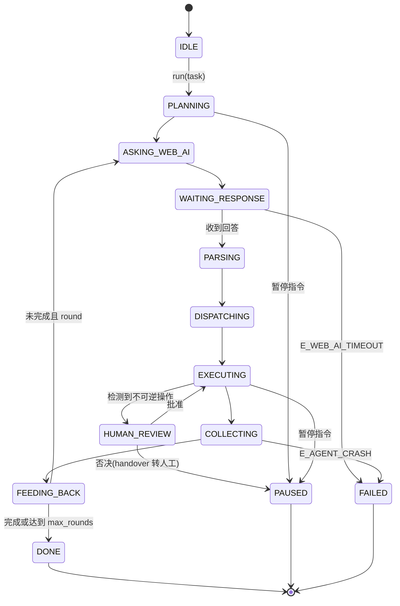
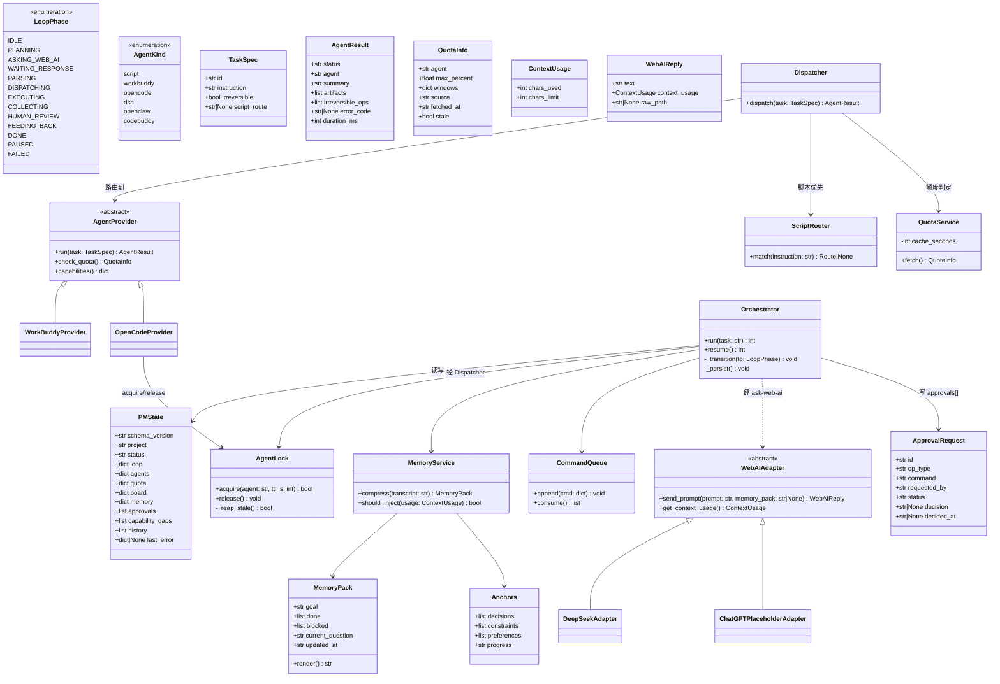
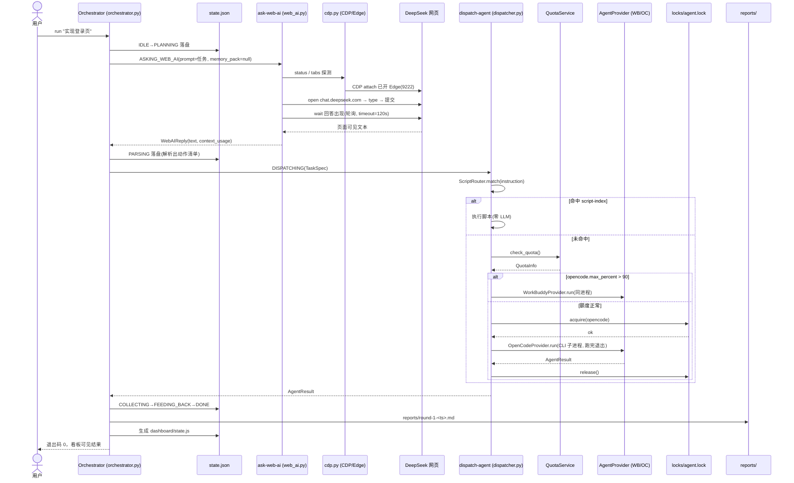
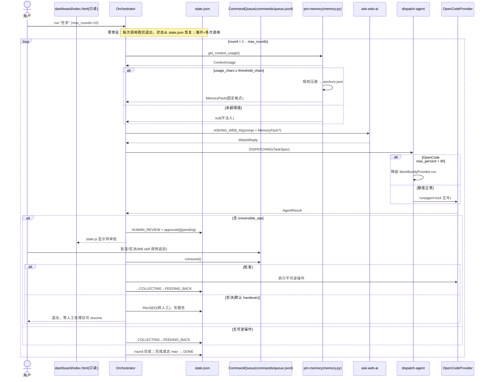
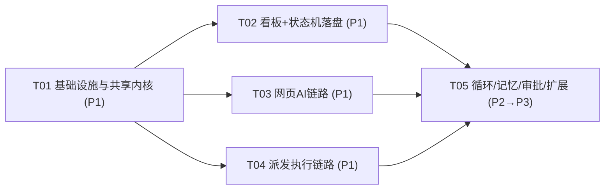

# ARCHITECTURE — Windows 本地「项目经理」编排器：系统架构设计 + 任务分解

> 版本：v1.0 · 作者：高见远（架构师） · 日期：2026-10-20
> 输入：PRD.md（许清楚，P1 基线）＋ 既定架构前提（8 条铁约束）
> 读者：工程师（照第 5 章任务清单执行）、团队负责人

---

## 1. 实现方案与框架选型

### 1.1 核心技术难点分析

| # | 难点 | 根因 | 设计对策 |
|---|------|------|----------|
| D1 | 内存铁约束 2.68GB 可用 | 任何常驻进程/服务都是风险 | **零常驻**：所有逻辑 = 项目级 skill + Python 脚本，按需启动、跑完退出；状态全部外置到 `state.json`，脚本可**随时重入恢复** |
| D2 | 看板要"实时"轮询但禁 Electron/禁常驻 HTTP 服务 | `file://` 页面被浏览器 CORS 拦截，`fetch('state.json')` 在 Edge 中不可用 | **双文件轮询**：编排器落盘 `state.json`（唯一真源）时同步生成 `dashboard/state.js`（`window.PM_STATE={...}`）；`dashboard/index.html` 用 `<script src="state.js">` 渲染 + `<meta http-equiv="refresh" content="2">` 整页重载实现 2 秒轮询。零服务、零依赖、file:// 可用 |
| D3 | 浏览器自动化不能下载 Playwright Chromium | 内存不够再养一个 Chromium | 只走 `browser-automation-cdp` skill 的 `scripts/cdp.py`（纯标准库自带精简 WebSocket 客户端，端口 9222 attach **已开 Edge**） |
| D4 | `max_concurrent_agents=1` | 两个编排入口可能并发拉起 OpenCode | `locks/agent.lock` 文件互斥 + **死 PID 清理**（`os.kill(pid,0)` 探活 + TTL 过期强制回收） |
| D5 | 网页 AI（DeepSeek）不是 API，是网页 | 无 SDK、页面选择器会变 | `ask-web-ai` 封装 CDP 五步固定流程（探测→导航→输入→等待→抽取），选择器与超时集中在 `web_ai.py` 常量区，一处维护 |
| D6 | 长会话遗忘早期决策 | 网页 AI 上下文有限且按会话 | `pm-memory` **规则压缩**（非 AI 自总结，省额度省内存）：字符阈值触发 → 固化 `memory/anchors.json` → 按固定格式生成记忆包随每轮提问注入 |
| D7 | OpenCode 额度可能耗尽 | 闭环不能中断 | `lib/quota.py` 查 `GET https://opencode.ai/zen/go/v1/usage`，5h/周/月三窗口取 max percent，60s 缓存，**>90% 自动降级 WorkBuddy，查不到不拦截** |

### 1.2 选型与理由

| 决策 | 选择 | 理由 |
|------|------|------|
| 编排载体 | **WorkBuddy 项目级 skill ×4 + Python 脚本** | WorkBuddy 5.8.3 是同进程宿主，skill 跑在 WB 进程内 = 零额外内存；skill 机制天然支持"按需唤起、跑完退出"；SKILL.md 给人看、.py 给机器跑，分层清晰 |
| 看板 | **单文件 HTML（Edge 只读）+ meta refresh 轮询** | PRD 与铁约束明确禁 Electron；file:// 下唯一可行轮询方案（见 D2）；看板只读，不发起任何写 |
| 浏览器自动化 | **只用 `browser-automation-cdp`** | 复用已开 Edge，不下载 Chromium；cdp.py 已验证纯标准库可跑。**SKILL.md 中写死禁止加载 `browser-agent` / `playwright-browser-agent`** |
| 本地执行器 | **WorkBuddy 默认 + OpenCode CLI 按需** | WB 同进程零内存做默认执行器；OpenCode 仅重活拉起，受 `agent.lock` 互斥，跑完即退 |
| 持久化 | **JSON/NDJSON 文件（P1-P2）→ SQLite（P3 可选）** | 现阶段数据量小，文件零依赖零服务；P3 再评估 SQLite |
| Python 依赖 | **标准库为主，零强制第三方** | 内存敏感 + 环境已具备 managed Python 3.13.12；HTTP 用 `urllib.request`，不引 requests |

**架构模式**：分层 + 状态机 + 适配器。
- 表现层：`dashboard/index.html`（只读）
- 编排层：`pm-orchestrator`（可重入状态机，唯一写 `state.json` 者）
- 服务层：`ask-web-ai`（WebAIAdapter）/ `dispatch-agent`（三段式路由 + AgentProvider）/ `pm-memory`（记忆）
- 数据层：`state.json` / `memory/` / `reports/` / `locks/` / `commands/`
- 跨层通信：**只走文件系统**（JSON + NDJSON），无 socket、无共享内存、无消息队列

### 1.3 关键机制设计

1. **可重入状态机（零常驻的核心）**：每次 skill 调用 = 一次"推进"。脚本启动先读 `state.json` 恢复现场，执行本阶段动作，落盘，退出。`WAITING_RESPONSE` 等长时等待也落盘——进程退出不丢状态，下次调用继续轮询。
2. **脚本优先路由**：`dispatch-agent` 先用 `script-index.json` 做关键词匹配，命中即执行脚本（零 LLM、零额度）；未命中才走 WB → OpenCode。
3. **额度路由**：`QuotaInfo.max_percent > 90` → 降级 WorkBuddy；`stale=true`（查不到）→ 放行不拦截。
4. **能力探测不阻塞**：DSH/OpenClaw/CodeBuddy 保持 `enabled:null`，探测失败记 `capability_gaps[]` 继续主流程。

---

## 2. 文件/目录列表（相对路径，根 = `pm-software/`）

```
pm-software/
├── ARCHITECTURE.md                    # 本文档
├── PRD.md                             # 产品需求（已有）
├── pm.config.json                     # 全局配置：路径/阈值/额度/看板刷新
├── capabilities.json                  # 代理能力探测结果（enabled:true|null）
├── script-index.json                  # 脚本优先路由索引（初版 10 条，禁收阿虎历史版）
├── state.json                         # 状态真源（唯一；编排器独占写）
├── skills/                            # 4 个项目级 skill
│   ├── pm-orchestrator/
│   │   ├── SKILL.md                   # 状态机说明 + 调用约定
│   │   └── orchestrator.py            # 状态机驱动 + 原子落盘 + state.js 生成
│   ├── ask-web-ai/
│   │   ├── SKILL.md                   # 封装 browser-automation-cdp；禁加载 browser-agent/playwright
│   │   └── web_ai.py                  # CDP 五步流程 + DeepSeek 选择器常量
│   ├── dispatch-agent/
│   │   ├── SKILL.md                   # 三段式路由说明
│   │   └── dispatcher.py              # 脚本优先→WB→OC + 锁 + 额度判定
│   └── pm-memory/
│       ├── SKILL.md                   # 阈值压缩 + 注入格式说明
│       └── memory.py                  # 规则压缩 + 记忆包渲染
├── lib/                               # 共享 Python 模块（被 4 个 skill 复用）
│   ├── pm_common.py                   # 路径解析/原子 JSON 读写/NDJSON/错误码/ISO 时间
│   ├── agent_lock.py                  # locks/agent.lock 互斥 + 死 PID 清理
│   ├── agent_provider.py              # AgentProvider ABC + WorkBuddy/OpenCode 实现 + AgentResult/QuotaInfo
│   ├── webai_adapter.py               # WebAIAdapter ABC + DeepSeekAdapter（P3 加 ChatGPTPlaceholder）
│   └── quota.py                       # OpenCode usage 查询 + 60s 缓存
├── dashboard/
│   ├── index.html                     # 单文件看板（只读，五区，meta refresh 2s）
│   └── state.js                       # 由编排器生成的窗口状态快照（看板数据源）
├── memory/
│   ├── anchors.json                   # 固化锚点：决策/约束/偏好/进度
│   └── transcripts/                   # 每轮问答归档 round-<n>-<ts>.md
├── reports/                           # 每轮 Markdown 报告 round-<n>-<ts>.md
├── locks/
│   └── agent.lock                     # 全局代理互斥锁（JSON：pid/agent/acquired_at/ttl_s）
└── commands/
    └── queue.jsonl                    # NDJSON 指令通道（模式B预留：批准/否决/暂停/恢复）
```

**script-index.json 初版 10 条路由**（全部实测存在；显式排除 `阿虎-*` 系列与 `截图-CDP-v014~v027` 历史版）：

| id | 脚本 | 路径 | runner |
|----|------|------|--------|
| shot-cdp | 截图-CDP.py（**最新版**） | `D:/wb/scripts/截图-CDP.py` | python |
| shot-window | 截图-窗口.py | `D:/wb/scripts/截图-窗口.py` | python |
| look-screen | 看屏.py | `D:/wb/scripts/看屏.py` | python |
| find-addressbar | 找地址栏.py | `D:/wb/scripts/找地址栏.py` | python |
| export-history | 导出-会话历史.py | `D:/wb/scripts/导出-会话历史.py` | python |
| update-board | 更新-进度看板.py | `D:/wb/scripts/更新-进度看板.py` | python |
| publish-version | 发布-版本化.js | `D:/wb/scripts/发布-版本化.js` | node |
| mkpage | download-page/mkpage.py | `D:/wb/scripts/download-page/mkpage.py` | python |
| settings-sync | 设定同步/sync.py | `D:/wb/scripts/设定同步/sync.py` | python |
| notify | wb-notify 通知脚本（notify.py，同伴 progress.py） | `D:/wb/scripts/notify/notify.py` | python |

浏览器核心（非路由，被 ask-web-ai 直接调用）：`C:/Users/Administrator/.workbuddy/skills/browser-automation-cdp/scripts/cdp.py`。

---

## 3. 核心数据结构与接口

### 3.1 状态机定义



> 可重入约定：除 IDLE 外任一状态落盘后进程退出均安全；下次调用从 `state.json` 恢复并继续。

### 3.2 类图（数据模型 + 服务类）



### 3.3 关键 JSON 结构示例

**state.json（看板唯一数据源，编排器独占写，原子落盘）**

```json
{
  "schema_version": "1.0",
  "project": "pm-software",
  "status": "RUNNING",
  "loop": {
    "round": 3,
    "max_rounds": 10,
    "phase": "EXECUTING",
    "current_agent": "opencode",
    "current_task": "实现登录页",
    "started_at": "2026-10-20T11:29:05Z",
    "updated_at": "2026-10-20T11:34:41Z"
  },
  "agents": {
    "workbuddy": { "kind": "in_process", "enabled": true },
    "opencode":   { "kind": "cli", "enabled": true },
    "dsh":        { "enabled": null },
    "openclaw":   { "enabled": null },
    "codebuddy":  { "enabled": null }
  },
  "quota": {
    "opencode": {
      "max_percent": 22,
      "windows": { "5h": 10, "week": 22, "month": 22 },
      "source": "https://opencode.ai/zen/go/v1/usage",
      "fetched_at": "2026-10-20T11:34:40Z",
      "degraded": false
    },
    "workbuddy": { "note": "同进程执行，无外部额度" }
  },
  "board": {
    "todo":      ["初始需求", "测试用例"],
    "asking":    ["DeepSeek"],
    "executing": ["WB:登录页", "OC:构建"],
    "approval":  ["apr-0007"],
    "done":      ["首页"]
  },
  "memory": {
    "last_injected_at": "2026-10-20T11:33:00Z",
    "threshold_chars": 24000,
    "usage_chars": 18500,
    "anchors": {
      "decisions":   ["用 MUI + Tailwind"],
      "constraints": ["内存 < 2.68GB"],
      "preferences": ["单文件 HTML 看板"],
      "progress":    "第3轮 登录页已完成"
    }
  },
  "approvals": [
    {
      "id": "apr-0007",
      "op_type": "git_push",
      "command": "git push origin main",
      "requested_by": "opencode",
      "status": "pending",
      "decision": null,
      "decided_at": null
    }
  ],
  "capability_gaps": [
    { "agent": "dsh", "reason": "探测接口未确认", "at": "2026-10-20T11:30:00Z" }
  ],
  "history": [
    { "round": 1, "phase": "DONE", "at": "2026-10-20T11:31:12Z" },
    { "round": 2, "phase": "DONE", "at": "2026-10-20T11:32:58Z" }
  ],
  "last_error": null
}
```

**AgentResult（AgentProvider.run 返回值）**

```json
{
  "status": "success",
  "agent": "opencode",
  "summary": "登录页已实现并通过构建",
  "artifacts": ["src/pages/Login.tsx"],
  "irreversible_ops": [
    { "type": "git_push", "command": "git push origin main" }
  ],
  "error_code": null,
  "duration_ms": 184000
}
```

**QuotaInfo（QuotaService.fetch 返回值）**

```json
{
  "agent": "opencode",
  "max_percent": 22,
  "windows": { "5h": 10, "week": 22, "month": 22 },
  "source": "https://opencode.ai/zen/go/v1/usage",
  "fetched_at": "2026-10-20T11:34:40Z",
  "stale": false
}
```

**MemoryPack（pm-memory 产物，render() 后随提问注入）**

```json
{
  "goal": "实现登录页并与后端联调",
  "done": ["项目脚手架", "首页静态页"],
  "blocked": [],
  "current_question": "登录接口的鉴权方案选 JWT 还是 Session？",
  "updated_at": "2026-10-20T11:33:00Z"
}
```

注入文本（固定格式，不得增删）：

```
【项目记忆·自动生成】
目标：实现登录页并与后端联调
已完成：项目脚手架；首页静态页
阻塞：无
【当前问题】
登录接口的鉴权方案选 JWT 还是 Session？
```

**commands/queue.jsonl（NDJSON 指令通道，模式B）**

```json
{"cmd": "approve", "id": "apr-0007", "by": "user", "at": "2026-10-20T11:36:00Z"}
{"cmd": "reject", "id": "apr-0007", "by": "user", "note": "先本地验证再推", "at": "2026-10-20T11:36:30Z"}
{"cmd": "pause", "by": "user", "at": "2026-10-20T11:37:00Z"}
```

---

## 4. 程序调用流程

### 4.1 时序图一：P1 单次往返（问 → 取 → 派 → 报告）



### 4.2 时序图二：P2 完整循环（含记忆注入 / 额度降级 / 人工审批）



---

## 5. 任务列表（T01–T05，按实现顺序；工程师照此执行）

> 分组原则：按功能模块/层次分组；每个任务 ≥3 个相关文件；配置文件全部集中在 T01。
> 阶段标注：P1=单次往返基线，P2=循环/额度/记忆/审批，P3=扩展抽象。

### T01 项目基础设施与共享内核（P1）

- **负责模块**：lib/ + 根配置
- **源文件**：`pm.config.json`、`capabilities.json`、`script-index.json`、`lib/pm_common.py`、`lib/agent_lock.py`、`state.json`（初始模板）、`.gitignore`
- **依赖**：无
- **优先级**：P0
- **内容**：
  1. `pm.config.json`：root、python 解释器路径（managed 3.13.12）、node、看板刷新秒数、记忆阈值（`threshold_chars=24000` / `limit_chars=120000`）、额度（usage URL、cache 60s、降级线 90%）、`max_rounds=10`、`reject_action=handover`。
  2. `script-index.json`：第 2 章 10 条路由 + `exclude` 字段显式排除 `阿虎-*`、`截图-CDP-v014~v027`；每条含 id/name/path/runner/match 关键词/llm=false。
  3. `lib/pm_common.py`：路径解析（相对 root）、`atomic_write_json`（tmp+`os.replace`）、`append_ndjson`、ISO8601 UTC 时间、错误码常量、退出码映射。
  4. `lib/agent_lock.py`：`acquire(agent, ttl_s=3600)` / `release()` / `_reap_stale()`（`os.kill(pid,0)` 探活，死 PID 或超 TTL 强制回收）；atexit 兜底释放。
- **验收标准**：
  - [ ] `python lib/pm_common.py --selftest` 通过（原子写/NDJSON/错误码）
  - [ ] `agent_lock` 单测：正常获取释放、并发第二次返回 `E_LOCK_BUSY`、写假 PID 后 `_reap_stale` 能回收
  - [ ] `script-index.json` 中 10 条路径全部 `os.path.exists` 通过；排除清单生效

### T02 看板 + 状态机落盘（P1）

- **负责模块**：pm-orchestrator + dashboard
- **源文件**：`skills/pm-orchestrator/SKILL.md`、`skills/pm-orchestrator/orchestrator.py`、`dashboard/index.html`、`dashboard/state.js`（生成物示例）
- **依赖**：T01
- **优先级**：P0
- **内容**：
  1. `orchestrator.py`：`run(task)` / `resume()` / `_transition()` / `_persist()`；状态机按 3.1 实现；每次转移原子落盘 `state.json` 并同步生成 `dashboard/state.js`；P1 只推进到 `PARSING` 后即返回 `E_SCRIPT_NOT_FOUND` 占位（T03/T04 完成后打通）。
  2. `SKILL.md`：写清调用方式（`orchestrator.py run "任务"` / `resume`）、状态语义、零常驻约定。
  3. `dashboard/index.html`：单文件、五区布局（循环状态/额度/看板/记忆/审批）、只读、`<script src="state.js">` + `<meta refresh 2s>`；额度条/待审批红标由 `window.PM_STATE` 驱动；不发起任何写操作。
- **验收标准**：
  - [ ] `orchestrator.py run "测试任务"` 后 `state.json` 出现 `PLANNING→ASKING_WEB_AI` 且字段齐全
  - [ ] `dashboard/state.js` 与 `state.json` 内容一致（`window.PM_STATE === state.json`）
  - [ ] Edge 打开 `dashboard/index.html`，2 秒内自动刷新且五区渲染正确；页面无任何 fetch/XHR 写操作

### T03 网页 AI 链路（P1）

- **负责模块**：ask-web-ai
- **源文件**：`skills/ask-web-ai/SKILL.md`、`skills/ask-web-ai/web_ai.py`、`lib/webai_adapter.py`
- **依赖**：T01
- **优先级**：P0
- **内容**：
  1. `lib/webai_adapter.py`：`WebAIAdapter` ABC（`send_prompt` / `get_context_usage`）+ `DeepSeekAdapter`（接口先行、单实现；P3 挂 `ChatGPTPlaceholderAdapter`）。
  2. `web_ai.py`：CDP 五步固定流程——①`cdp.py status/tabs` 探测（不可达→`E_CDP_UNREACHABLE` 并提示启动调试 Edge）②`open https://chat.deepseek.com`（落到登录页→`E_WEB_AI_NOT_LOGGED_IN`）③`type` 输入框 + 提交 ④`wait` 轮询回答容器（timeout 120s→`E_WEB_AI_TIMEOUT`）⑤`text` 抽取回答文本；选择器/超时集中在常量区。
  3. `SKILL.md`：**写死禁止加载 `browser-agent` / `playwright-browser-agent`**；只允许调用 `browser-automation-cdp` 的 `scripts/cdp.py`；不下载 Chromium。
- **验收标准**：
  - [ ] 对已登录 DeepSeek 完成一次"提问→取答"，返回文本非空且 `context_usage` 合理
  - [ ] 未登录场景返回 `E_WEB_AI_NOT_LOGGED_IN`，主流程记 `last_error` 不崩溃
  - [ ] CDP 不可达返回 `E_CDP_UNREACHABLE`；全程无 Playwright/Chromium 进程产生

### T04 派发与执行链路（P1）

- **负责模块**：dispatch-agent
- **源文件**：`skills/dispatch-agent/SKILL.md`、`skills/dispatch-agent/dispatcher.py`、`lib/agent_provider.py`、`lib/quota.py`
- **依赖**：T01
- **优先级**：P0
- **内容**：
  1. `lib/agent_provider.py`：`AgentProvider` ABC（`run(task)->AgentResult` / `check_quota()->QuotaInfo` / `capabilities()`）+ `WorkBuddyProvider`（同进程，默认执行器）+ `OpenCodeProvider`（CLI 子进程按需拉起，跑完退出，`acquire/release` 走 `agent.lock`）。
  2. `lib/quota.py`：`urllib.request` GET usage URL；5h/周/月取 max；60s 缓存（内存 + `fetched_at` 落盘）；`stale=true` 不拦截。
  3. `dispatcher.py`：三段式路由——①`ScriptRouter.match` 命中 `script-index.json` 执行脚本（零 LLM）②未命中且 OpenCode `max_percent>90` → 降级 WB ③否则 OpenCode（持锁）。
- **验收标准**：
  - [ ] 构造命中 script-index 的任务，全程零 LLM 调用即完成
  - [ ] mock `max_percent=95` 时路由到 WorkBuddy；`stale=true` 时放行不拦截
  - [ ] 并发两次 OpenCode 任务，第二次得 `E_LOCK_BUSY`；usage 接口 60s 内不重复请求

### T05 循环 / 记忆 / 审批 / 扩展（P2 → P3）

- **负责模块**：pm-memory + 编排增强
- **源文件**：`skills/pm-memory/SKILL.md`、`skills/pm-memory/memory.py`、`memory/anchors.json`、`memory/transcripts/`、`reports/`、`commands/queue.jsonl`、`skills/pm-orchestrator/orchestrator.py`（增强：循环/HUMAN_REVIEW/consume 指令）、`lib/webai_adapter.py`（P3 扩展）、`capabilities.json`（探测）
- **依赖**：T02、T03、T04
- **优先级**：P1
- **内容**：
  1. **P2-a 循环状态机**（P1-1）：`FEEDING_BACK→ASKING_WEB_AI` 多轮直至完成或 `max_rounds`；每轮归档 `memory/transcripts/round-<n>-<ts>.md`。
  2. **P2-b 记忆压缩与注入**（P1-3）：`memory.py` 规则压缩（字符阈值触发，非 AI 自总结）→ 固化 `anchors.json`（决策/约束/偏好/进度）→ 按 3.3 固定格式渲染记忆包，随每轮提问注入；`should_inject(usage)` 阈值判定。
  3. **P2-c 人工审批**（P0-5）：`AgentResult.irreversible_ops` 非空 → `HUMAN_REVIEW` + `approvals[]`；orchestrator `consume()` 读 `commands/queue.jsonl`：批准→执行；否决→默认 `handover`（PAUSED 转人工，可 resume）；暂停/终止/重试指令同理。
  4. **P2-d 能力探测**（P1-5）：DSH/OpenClaw/CodeBuddy 探测写 `capabilities.json`，保持 `enabled:null`，失败记 `capability_gaps[]` 不阻塞。
  5. **P3 扩展**（P2-1~P2-4）：`WebAIAdapter` 抽象落地 + `ChatGPTPlaceholderAdapter` 占位；WorkBuddy 实现类细化；SQLite 持久化 reports/记忆索引（可选，`sqlite3` 标准库）。
- **验收标准**：
  - [ ] 多轮循环跑通：轮次递增、`max_rounds` 到顶自动 `DONE`
  - [ ] 构造超长会话，阈值触发后 `anchors.json` 更新且注入文本严格符合固定格式
  - [ ] 不可逆操作进入 `HUMAN_REVIEW`；批准后执行、否决后 `PAUSED` 且可 `resume`
  - [ ] DSH/OpenClaw/CodeBuddy 探测失败时主流程继续，`capability_gaps` 有记录
  - [ ] P3：新增 ChatGPT 占位 adapter 不改动编排层代码

---

## 6. 依赖包清单

**Python（managed 3.13.12，路径见 pm.config.json）**

```
# 零强制第三方。全部使用标准库：
# json / os / sys / time / subprocess / urllib.request / socket / atexit / pathlib / argparse / re / datetime / hashlib / sqlite3(P3)
```

**明确不引入**：
- ❌ `playwright` / `playwright-browser-agent`：不下载 Chromium，浏览器只走 `browser-automation-cdp` 的 `cdp.py`（自带标准库 WebSocket 客户端）
- ❌ `requests`：HTTP 统一用 `urllib.request`
- ❌ `electron` / 任何常驻服务进程 / 消息队列 / Web 框架

**Node（本机 22.22.2，仅 `发布-版本化.js` 路由需要）**：无新增包。

---

## 7. 共享知识（跨文件约定，所有任务必须遵守）

1. **状态真源唯一**：`state.json` 只能由 `orchestrator.py` 写；其他脚本只读。看板只读 `dashboard/state.js`（由编排器生成，内容 = state.json）。
2. **原子写**：所有 JSON 写入 = 写 `<path>.tmp` → `os.replace(<path>)`；绝不让看板读到半个文件。
3. **NDJSON**：`commands/queue.jsonl` 一行一条 JSON，append-only；消费方读后重写为剩余未处理行（或打 consumed 标记），不得并发双消费。
4. **锁文件协议**：`locks/agent.lock` = `{pid, agent, acquired_at, ttl_s}`。acquire：文件存在→读 pid→`os.kill(pid,0)` 存活且未超 TTL→返回 `E_LOCK_BUSY`；否则判死残留，删除后重取。release：删文件。进程退出（atexit / finally）必须释放。
5. **记忆包注入固定格式**（禁止增删行）：
   ```
   【项目记忆·自动生成】
   目标：<一句话>
   已完成：<分号分隔，≤3 条>
   阻塞：<无则写"无">
   【当前问题】
   <本轮问题全文>
   ```
6. **skill 间通信**：只走文件系统（`state.json` / `commands/queue.jsonl` / `reports/` / `memory/`），无 socket、无共享内存、无网络（除 OpenCode usage API 与网页 AI 本身）。
7. **错误码约定**：`E_OK=0`；`E_LOCK_BUSY=10`；`E_QUOTA_EXCEEDED=20`；`E_WEB_AI_TIMEOUT=30`；`E_WEB_AI_NOT_LOGGED_IN=31`；`E_CDP_UNREACHABLE=32`；`E_AGENT_CRASH=40`；`E_AGENT_RESULT_INVALID=41`；`E_HUMAN_REJECTED=50`；`E_SCRIPT_NOT_FOUND=60`；`E_CAPABILITY_GAP=70`（记录不阻塞）；`E_STATE_CORRUPT=80`。进程退出码与错误码一致；`cdp.py` 不可达沿用其退出码 2 时映射为 `E_CDP_UNREACHABLE`。
8. **时间**：存储一律 ISO 8601 UTC（`datetime.now(timezone.utc).isoformat()`）；看板展示层转本地时间。
9. **路径**：一律相对 `pm.config.json` 的 `root`；Windows 路径统一正杠 `/`；Python 解释器固定用 managed 3.13.12。
10. **能力缺口**：任何代理探测失败 → `capability_gaps[]` 记录 + 继续，**不得 raise 阻塞主流程**。

---

## 8. 待明确事项

### 8.1 对 PRD 七个问题的架构默认值（已按此设计，如需推翻请指示）

| # | 问题 | 架构默认值 | 依据 |
|---|------|-----------|------|
| Q1 | WorkBuddy 触发方式 | **模式 B：WB 同进程回写 `state.json`**。编排器 skill 就跑在 WB 宿主进程内，天然零内存直写；看板仍只读。`commands/queue.jsonl` 为模式 B 指令通道预留 | WB 5.8.3 是同进程宿主（既定前提），模式 A 的"纯轮询无 WB"反而要外挂进程 |
| Q2 | 网页 AI 会话 | DeepSeek 需用户**首次手动登录一次**（Edge profile 持久化 cookie）；`cdp.py` 经 9222 端口 attach 已开 Edge，可接管已登录标签页；未登录→`E_WEB_AI_NOT_LOGGED_IN` 暂停等人工 | CDP attach 复用实例是既定方案；登录态属用户隐私cookie，不代管 |
| Q3 | 额度数据源 | `GET https://opencode.ai/zen/go/v1/usage`，5h/周/月三窗口取 **max percent**；60s 缓存；**查不到不拦截** | 既定架构前提第 5 条 |
| Q4 | 记忆阈值单位 | **按字符数**（不引 tokenizer，省内存）：`threshold_chars=24000`（≈16K tokens，按 1 token≈1.5 字符折算留余量），`limit_chars=120000`；各 AI 上限配置在 `pm.config.json` | 规则压缩要求零依赖；中文场景字符数可直接度量 |
| Q5 | 否决后策略 | 默认 **(b) 转人工**（handover）：任务标 `needs_human`、状态机→`PAUSED`、写报告、可 resume；`pm.config.json` 可改 `terminate`/`retry_other_agent` | 与"保留人工否决权、不追求完全无人化"的产品边界一致 |
| Q6 | 报告呈现 | **双写**：实时进度只写 `state.json`（+`state.js`）供看板；每轮 `DONE/FAILED` 时在 `reports/round-<n>-<ts>.md` 落 Markdown 报告 | 看板单屏只看摘要；报告留痕供回溯 |
| Q7 | ChatGPT 占位时机 | **P3**（与既定阶段叙事一致）：P1 的 `ask-web-ai` 内部先以 `WebAIAdapter` 接口形态实现 `DeepSeekAdapter`（接口先行），P3 挂 `ChatGPTPlaceholderAdapter`，编排层零改动 | 需求池标 P2-nice-to-have，但阶段叙事归 P3；接口先行消除返工 |

### 8.2 仍需用户/负责人拍板

1. **看板轮询方式**：`meta refresh 2s` 整页重载（有闪烁、丢滚动位置）是否可接受？若不可接受，唯一替代是轻量 `http.server`（≈10MB 常驻，违背零常驻铁约束）——建议维持默认。
2. **OpenCode CLI 调用契约**：`opencode run "<prompt>"` 的确切参数、退出码、输出格式需在 T04 实测后固化到 `OpenCodeProvider`。
3. **DeepSeek 页面选择器**：输入框/发送按钮/回答容器的 CSS 选择器需在 T03 实测后固化到 `web_ai.py` 常量区（页面改版时只改这一处）。
4. **项目级 skill 发现机制**：假设 WorkBuddy 5.8.3 自动发现 `<项目>/skills/`；若不支持，需将 4 个 skill 复制/软链到 `~/.workbuddy/skills/`（T02 验收时验证）。
5. **usage API 返回体结构**：设计按 `{windows:{5h/week/month:{percent}}}` 假设，实测后修正 `lib/quota.py` 解析。

---

## 9. 任务依赖图



> T02/T03/T04 在 T01 完成后可并行；T05 集成三者。关键路径：T01 → T03 → T05（网页 AI 实测不确定性最高，最早启动）。
